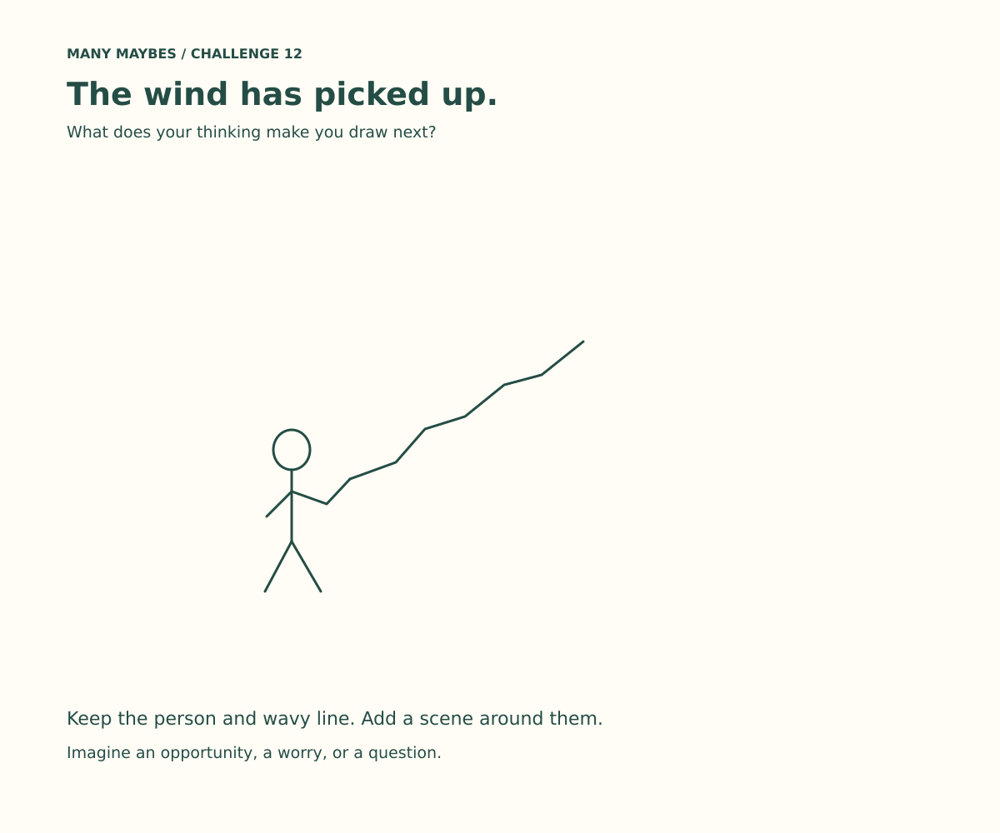

# Challenge 12 — Same shape. Different story.

Start with one faceless stick figure standing on a horizontal line. Create three scenes around the exact same starter. What can you make someone imagine by changing the surroundings?

## Try it

1. Copy the starter three times, or run `starter.py` with Python Turtle.
2. Keep the figure, pose, line, and their relative positions unchanged. Do not erase, cover, move, or reshape the starter. Uniformly scaling the entire drawing is allowed.
3. Add surroundings to suggest three different situations. Keep the starter clearly visible. Color is optional; aim to communicate through shapes and placement first.
4. Give each scene a title and identify the two added clues that contribute most to its meaning.
5. Show the pictures without titles to someone. Ask what they see before explaining your intention. Different readings are welcome.

Paper, freehand drawing and Turtle all work. Rough sketches count. A text-only alternative is to describe three settings around the unchanged person and line, naming two clues for each.

## Thinking hints

- What could the line be a part of?
- What could be above, beneath, or beside the person?
- What would make the same pose seem cautious, performative, or restful?
- What is visibly present, and what story are you inferring?
- Can you remove a detail while keeping the interpretation clear?

## Three illustrative possibilities

These are examples, not correct answers or participant submissions.

| Example | Added strokes and why | Possible interpretation |
|---|---|---|
| [Bridge](challenge-12-bridge.svg) | Cliff edges establish a gap; the deck gives the line structure; distant water establishes height. | A cautious crossing. |
| [Stage](challenge-12-stage.svg) | A stage front gives the line a platform; curtains locate the scene; an audience introduces being watched. | A performer pausing, or someone nervous about beginning. |
| [Jetty](challenge-12-jetty.svg) | Planks and supports establish a jetty; shore and ripples locate it beside water. | A quiet pause, or someone waiting. |

## Connection to the seedling example

Imagine ten seedlings: six grew and four did not. “Six grew” and “Four did not grow” emphasize different aspects of the same result. This is an introductory illustration of framing; it does not establish that every viewer will react differently.

In our drawing exercise, the fixed person and line play the role of the unchanged seedlings. The surrounding details play a role similar to the captions in guiding interpretation. The analogy has a limit: captions rephrase the same facts, whereas bridge, stage and jetty details introduce new information and create different situations. Label this activity **visual context and interpretation**, with framing as the related introductory concept, not as an exact controlled demonstration of the framing effect.

Reflection: What did you draw, and what did the viewer's imagination add? What changed when you supplied a title?

## Turtle sources and accessibility

Run `python -i starter.py` (or `bridge.py`, `stage.py`, `jetty.py`) with Python 3 and Tkinter installed. Interactive mode keeps the window open. Scripts are standalone and use visible `st()` for drawing, `ht()` for pen-up travel and final viewing. They create no audio or video. All SVGs include descriptive titles and alternative text; `manifest.json` also records descriptions and the exact fixed geometry.

Video screenplays are prepared separately in the private source repository. Video creation is on hold. This Git update does not deploy a website page.
