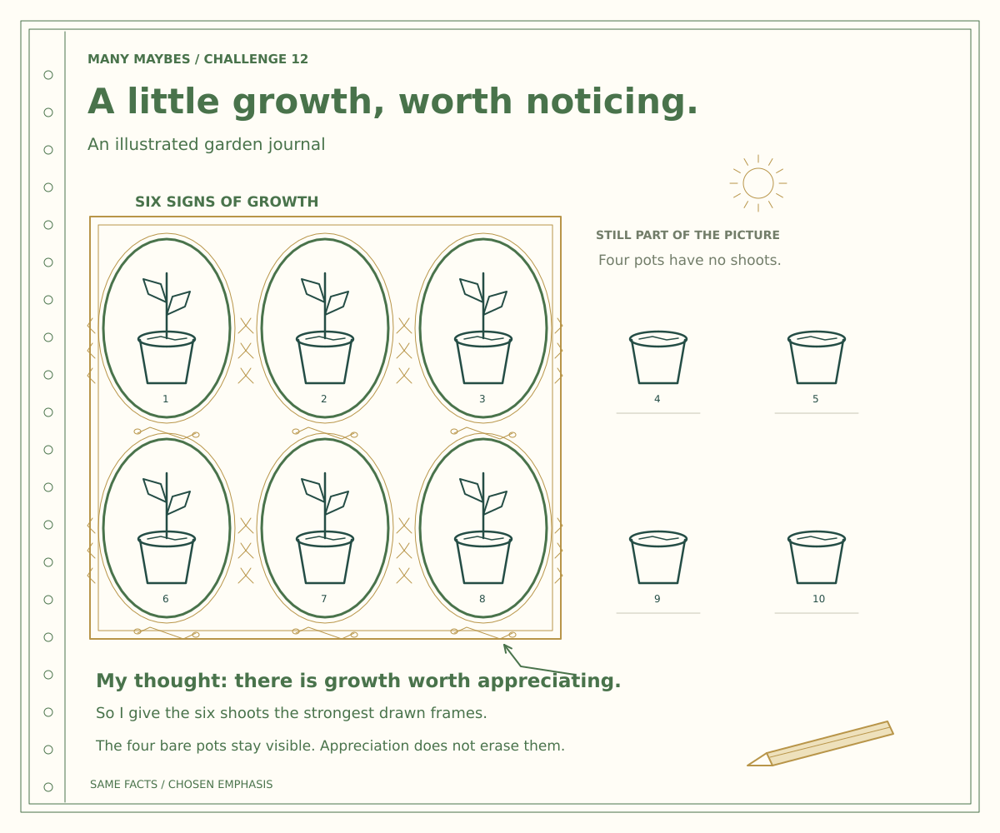
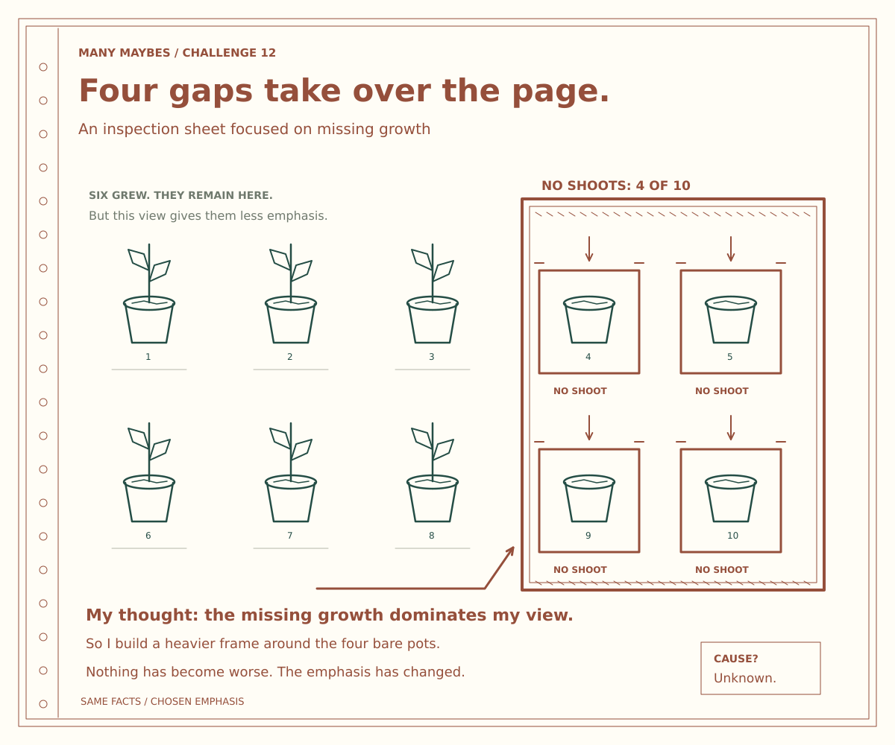
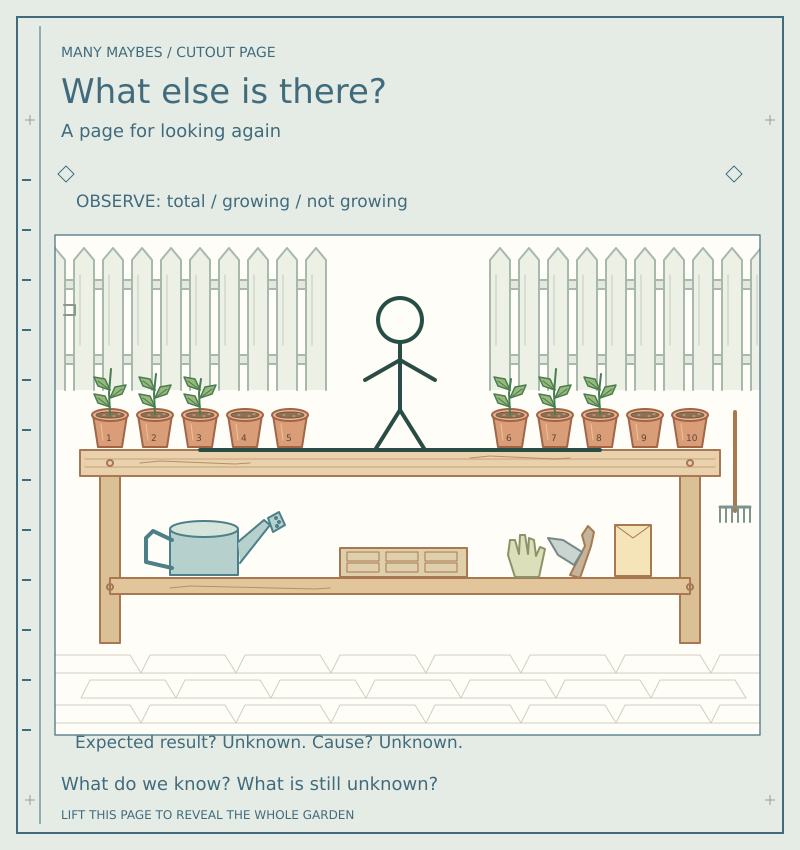

# Challenge 12 — Same garden. Different frame.

**Revision 3: cutout-book edition.** One detailed garden sits behind three illustrated paper pages. Their openings reveal different evidence. Lift a page to discover what it hid.

## Review the designs

| Page | Closed-page design | Transparent overlay | Cutting template |
|---|---|---|---|
| Optimism | [Look what grew](challenge-12-optimism.svg) | [Six windows](optimism-overlay.svg) | [Template](optimism-cut-template.svg) |
| Pessimism | [Look what is missing](challenge-12-pessimism.svg) | [Four windows](pessimism-overlay.svg) | [Template](pessimism-cut-template.svg) |
| Curiosity | [What else is there?](challenge-12-curiosity.svg) | [Wide window](curiosity-overlay.svg) | [Template](curiosity-cut-template.svg) |

[The complete garden revealed](garden-base.svg) · [Detailed design and assembly plan](DESIGN-PLAN.md)

Download `review.html` and open it in a browser for a self-contained page-lift comparison and print layouts. GitHub displays its source rather than running it. No website deployment or sign-in is needed.

## The challenge

Use the supplied complete garden as your starter. Design three opaque foreground pages with openings that invite optimistic, pessimistic and curious readings. Keep the base unchanged: ten pots, six with shoots, four without. You may hide parts with the foreground page; you may not alter the underlying result. Explain your thought, the evidence you reveal, the evidence you conceal and the feeling you intend. Then lift the page and ask whether your viewer's impression changes.

The old person-and-line starter remains within the garden but is no longer the entire task brief. The original seedling wording example introduces the related idea of framing. Masks go further by withholding evidence: say so explicitly. Different viewers may respond differently; the images are not a psychological test.

## Assemble or draw

Print base and overlay at identical scale. Cut the inner openings and align the registration crosses. Place **one overlay at a time** over the base. Do not stack all three. Read the detailed plan before assembly; a physical print/cut trial has not yet been performed.

`optimism.py`, `pessimism.py`, `curiosity.py` draw the paper and aperture boundaries with visible Turtle strokes. They do not simulate transparency by painting white. The complete editable art and real holes are in the SVG layers. `scene.json` holds the shared garden paths; `manifest.json` defines the aperture coordinates. `starter.py` remains the historical simple shape. Run Turtle scripts with `python -i filename.py` to keep the window open.

Text-only participation: describe what each page would reveal or hide and what its lift would show. SVGs have descriptive titles and descriptions; the local review offers labelled keyboard-operable buttons, text descriptions and reduced motion.

Video screenplays are updated in the private source repository. **Video creation remains on hold.** This Git revision does not publish a website page.
