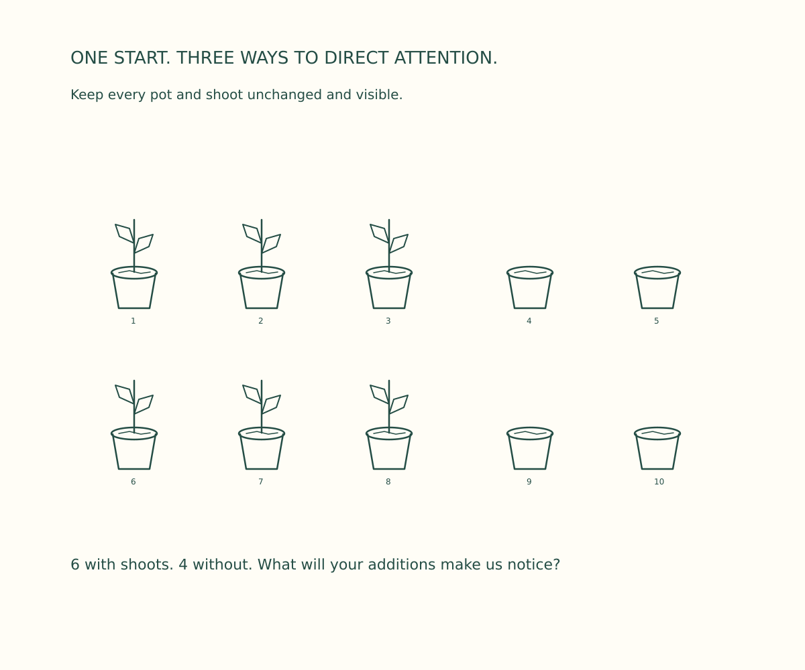
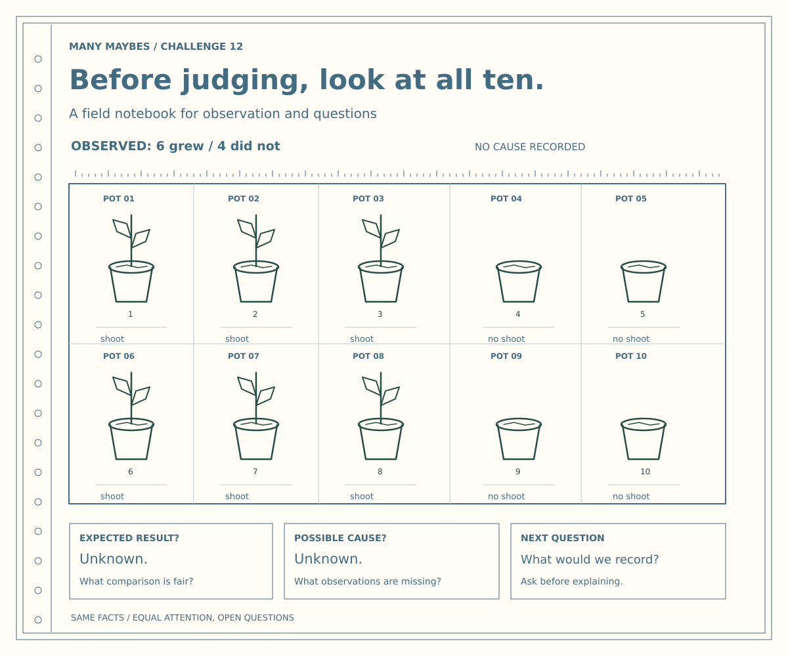

# Challenge 12 — Same start. Different emphasis.

Revision 4 restores the Many Maybes format: **one simple fixed starter → three different illustrated interpretations**. Cutout pages are an optional second stage, not the main task.

## The starter

[Download starter SVG](challenge-12-starter.svg) · [PNG](challenge-12-starter.png) · [Turtle source](starter.py)

Ten simple pots in two rows. The first three in each row have two-leaf shoots; the remaining two have none. Keep all original marks, positions and growth unchanged and visible. The unrelated person-and-line starter has been removed.

## Three illustrations

### Optimism — A little growth, worth noticing

An illustrated garden journal groups six growing pots inside ornate green-and-gold medallions, with scrollwork and a drawn pencil. The four bare pots remain plainly visible. Thought: **there is growth worth appreciating**. Drawing decision: give that evidence the most prominent frames and detail.

### Pessimism — Four gaps take over the page

A heavy rust-colored inspection block surrounds the four bare pots. Arrows, brackets and hatching concentrate attention on their lack of shoots. Six growing pots remain visible on the left. Thought: **the missing growth dominates my view**. Drawing decision: make the four absences the page's strongest visual group.

### Curiosity — Before judging, look at all ten

A blue field-notebook grid gives every pot equal space, labels and observation lines. Question boxes distinguish the known counts from unknown expectations and causes. Thought: **understand before judging**. Drawing decision: organize both outcomes equally and leave room for questions.

## Your task

1. Copy the starter three times. Keep every pot and shoot unchanged, in the same relative position. Uniform scaling of the whole starter is allowed.
2. Add drawings around the starter to suggest optimism, pessimism and curiosity. Use composition, frames, annotation lines, color, decorative detail and captions. Do not cover or move the starter.
3. Explain: **my thought → evidence selected → marks added → intended feeling**.
4. Show the pictures without explaining your intended viewpoint first. Ask what someone notices and how they interpret the result. A different reaction is useful feedback.

Do not invent a cause, extra growth, dead roots or a changed outcome. Six grew; four did not. Good/bad performance cannot be established without an expectation or comparison. Curiosity is an inquiry stance, not a claim of perfect neutrality.

## Optional second stage: cutout reveal

Only after finishing the additive drawings, make a separate removable mask. `optimism-overlay.svg` reveals the six growing pots; `pessimism-overlay.svg` reveals four bare pots; `curiosity-overlay.svg` reveals all ten. Every mask uses the new 1200×1000 coordinate system and can be aligned over an illustration. Lift to reveal what was hidden. Do not apply the old revision-3 templates: they used different geometry.

The distinction matters: added frames **emphasize visible evidence**; optional masks **withhold evidence**. Both guide interpretation, but they are not identical mechanisms.

## Review and source

Download `review.html` and open locally. It includes the starter, all three illustrations and optional mask toggles. No deployment or sign-in is needed. GitHub shows HTML source instead of running it.

SVG and PNG files are provided. Standalone Turtle scripts use the same polyline geometry, show the turtle during active strokes, and hide it during travel and final holds. Run `python -i optimism.py`, `pessimism.py`, `curiosity.py` or `starter.py`. Text is written as labels; drawing strokes are traced. No video or audio is produced.

See [the design plan](DESIGN-PLAN.md) and [validation record](VALIDATION.md). Private production screenplays are updated. **Video creation remains on hold; no website deployment is included.**
